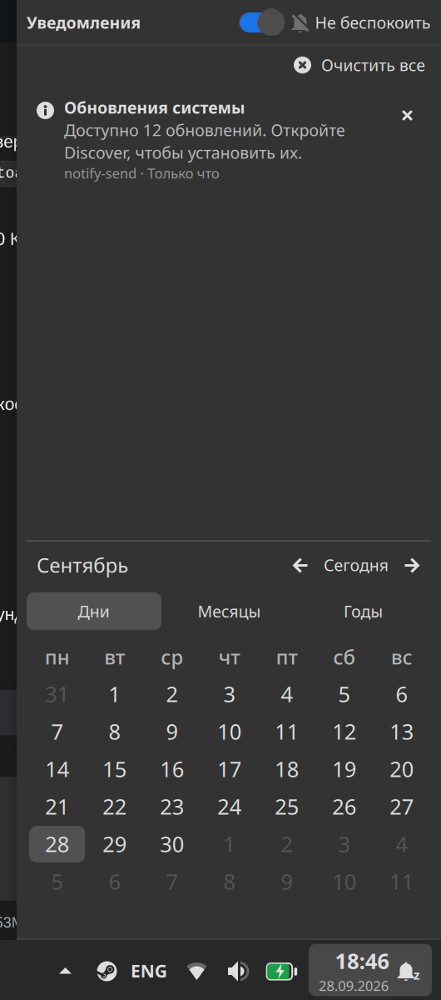
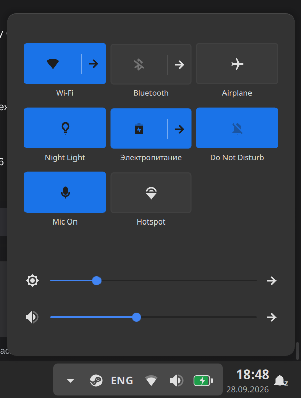
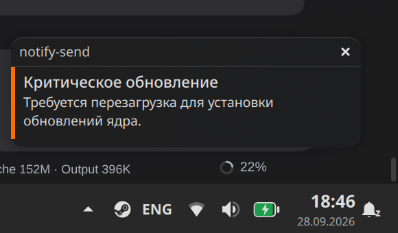

# plasmoids — монорепозиторий плазмоидов Win11 для KDE Plasma 6

Пять апплетов в стиле Windows 11 для панели KDE Plasma 6 (Qt 6 / KF6).
Единый репозиторий нужен, чтобы изменения можно было откатывать через git.
Репозиторий: <https://github.com/mops1k/kde6-win11-plasmoids> (ветка `main`).

## Состав

| Каталог | id апплета | Тип | Что это |
| --- | --- | --- | --- |
| `win11tray/` | `org.mops1k.win11tray` | C++ / CMake | замена системного трея, сводный поповер быстрых настроек |
| `win11tasks/` | `org.mops1k.win11tasks` | C++ / CMake | таскбар icons-only с Win11-тултипами и превью |
| `win11battery/` | `org.mops1k.win11battery` | QML (KPackage) | батарея с процентом внутри, системное меню питания |
| `win11clock/` | `org.mops1k.win11clock` | QML (KPackage) | часы над датой, уведомления, календарь, «Не беспокоить» |
| `win11keyboardlayout/` | `org.mops1k.win11keyboardlayout` | QML (KPackage) | индикатор раскладки (РУС/ENG) с настройками шрифта |

Проектные детали (сборка, зависимости, грабли) — в `AGENTS.md` каждого каталога.

## Предпросмотр

Панель целиком (таскбар, трей, часы, индикатор раскладки, батарея):


Поповер часов — календарь, история уведомлений и переключатель «Не беспокоить»:



Поповер трея — сводные быстрые настройки (сеть, Bluetooth, ночной свет,
электропитание, «Не беспокоить», микрофон, точка доступа, яркость, громкость):



Всплывающее уведомление (toast) от плазмоида часов:



## Установка без сборки (готовый релиз)

Релизы собираются в CI ([`.github/workflows/release.yml`](.github/workflows/release.yml),
тег `v*`) и содержат уже скомпилированные C++-плазмоиды `win11tray`/`win11tasks`,
QML-плагин уведомлений, `.plasmoid` для QML-плазмоидов и переводы. Компилятор
и cmake не нужны:

```bash
curl -fsSL https://raw.githubusercontent.com/mops1k/kde6-win11-plasmoids/main/scripts/online-install.sh | bash
```

Скрипт находит последний релиз, проверяет sha256, распаковывает архив в
`~/.cache/win11-plasmoids/<тег>` и запускает установщик из самого архива.
Варианты запуска:

```bash
# без интерактивного выбора
curl -fsSL .../scripts/online-install.sh | bash -s -- --all
curl -fsSL .../scripts/online-install.sh | bash -s -- --only win11tray,win11clock --no-restart
curl -fsSL .../scripts/online-install.sh | bash -s -- --tag v0.1.0   # конкретная версия
curl -fsSL .../scripts/online-install.sh | bash -s -- --list         # список релизов

# уже скачанный архив (без сети)
bash scripts/online-install.sh --from ~/Загрузки/win11-plasmoids-v0.1.0-x86_64-arch.tar.gz --all
```

Вручную, без однострочника:

```bash
curl -LO <ссылка на архив релиза>          # и на тот же файл с суффиксом .sha256
sha256sum -c win11-plasmoids-v0.1.0-x86_64-arch.tar.gz.sha256
tar xzf win11-plasmoids-v0.1.0-x86_64-arch.tar.gz
cd win11-plasmoids-v0.1.0
./scripts/install.sh --prebuilt-dir prebuilt --all --no-restart
```

Что важно знать:

- готовые C++-артефакты собраны для Arch-семейства, x86_64, Plasma 6.8 / Qt 6.12.
  Установщик сверяет версии Plasma и Qt и проверяет `ldd` по каждому `.so`;
  если система старше, `win11tray`, `win11tasks` и QML-плагин `win11clock`
  собираются из исходников (тогда нужны пакеты из раздела «Требования»),
  а `.plasmoid` QML-плазмоидов ставятся из релиза как есть. `--no-fallback`
  вместо отката останавливает установку;
- установка идёт в `~/.local`, root не нужен; панель по-прежнему
  переключается на свои плазмоиды (отключается `--no-switch`/`--no-restart`);
- QML-плазмоид можно поставить и вовсе без скриптов: к релизу приложены файлы
  `org.mops1k.win11*.plasmoid` (ПКМ по панели → «Добавить виджеты» →
  «Установить из файла…»), но перевода и автопереключения в панели тогда нет;
- зависимости установки: `bash`, `curl`, `tar`, `python3`, `kpackage`
  (утилита `kpackagetool6`) и `systemd`; для `win11battery` — `powerdevil`.

Проверка релиза без установки: `bash scripts/online-install.sh --list`.

## Сборка и установка из исходников

### 1. Требования

KDE Plasma 6 на Wayland (KWin). Проверено на Plasma 6.7.5, Qt 6.11.2, KF6 6.30
(CachyOS/Arch); сборка C++-плазмоидов проверена и на Plasma 6.8.0. Различия
API между 6.7 и 6.8 (`loadApplet`/`addApplet` на `std::unique_ptr`,
удалённый `PlasmaQuick::SharedQmlEngine`) учтены в `win11tray` и `win11tasks`.
Пакеты для сборки:

```bash
sudo pacman -S --needed base-devel cmake extra-cmake-modules kpackage gettext \
    qt6-wayland wayland plasma-workspace plasma-wayland-protocols \
    plasma-activities plasma-activities-stats libksysguard
```

Остальные Qt6/KF6-модули приходят зависимостями `plasma-workspace`.
`powerdevil` нужен для win11battery (системное меню «Питание и батарея»),
`python3` и `git` — для скриптов правки `appletsrc` и клонирования.

### 2. Клонирование

```bash
git clone https://github.com/mops1k/kde6-win11-plasmoids.git
cd kde6-win11-plasmoids
```

### 3. Установка плазмоидов

```bash
./scripts/install.sh              # интерактивный выбор (zenity-чекбоксы)
./scripts/install.sh --all        # установить все
./scripts/install.sh --only win11tray,win11clock
./scripts/install.sh --list       # только показать список
./scripts/install.sh --no-switch  # установить, но не трогать панель

./scripts/install.sh --release              # то же, но готовым релизом (без сборки)
./scripts/install.sh --prebuilt-dir <dir>/prebuilt   # из распакованного релиза
```

Флаги `--release [тег]` и `--prebuilt-dir <каталог>` переключают установщик на
готовые артефакты (см. раздел «Установка без сборки»); без них скрипт собирает
C++-части локально.

Выбор плазмоидов — диалог `zenity --list --checklist`; если zenity или
графическая сессия недоступны, используется whiptail, затем текстовое
нумерованное меню.

Что делает установщик (всё в `~/.local`, root не нужен):

- C++-плазмоиды `win11tray` и `win11tasks` собираются CMake в `build/`,
  плагины ставятся в `~/.local/lib/qt6/plugins/plasma/applets`;
- QML-плазмоиды `win11battery`, `win11clock`, `win11keyboardlayout` ставятся
  `kpackagetool6` в `~/.local/share/plasma/plasmoids`;
- C++ QML-плагин уведомлений `win11clock/notifications` собирается в
  `~/.local/lib/qt6/qml/org/mops1k/win11clock/notifications`;
- переводы (`.mo`) ставятся в `~/.local/share/locale`;
- создаются systemd drop-in'ы `~/.config/systemd/user/plasma-plasmashell.service.d/`
  с `QT_PLUGIN_PATH` и `QML_IMPORT_PATH` — без них plasmashell не увидит
  C++-плагины;
- `plasmashell` перезапускается один раз в конце (`--no-restart` отключает).

После установки отмеченные плазмоиды автоматически переключаются на свои в
панели: `plasmashell` останавливается один раз, для каждого плазмоида
вызывается его `win11*/scripts/switch-*.sh --no-restart` (правка appletsrc с
бэкапом), затем панель запускается снова. Если в панели нет системного
апплета (например, `digitalclock`), установщик предупреждает и продолжает.
`--no-switch` отключает переключение, `--no-restart` пропускает и перезапуск,
и переключение.

### 4. Сборка панели как на скриншоте

Системные апплеты заменяются на свои уже при установке (`./scripts/install.sh`).
Отдельные скрипты нужны для ручной замены или отката: каждый делает бэкап
`~/.config/plasma-org.kde.plasma.desktop-appletsrc` и правит его при
остановленном `plasmashell`; `--revert` возвращает системный апплет,
`--no-restart` оставляет перезапуск панели вызывающему скрипту:

```bash
win11tasks/scripts/switch-tasks.sh            # таскбар вместо системного icontasks
win11tray/scripts/switch-tray.sh              # трей вместо системного
win11clock/scripts/switch-clock.sh            # часы вместо digitalclock
win11battery/scripts/switch-battery.sh        # батарея внутрь трея
win11keyboardlayout/scripts/switch-widget.sh  # индикатор раскладки внутрь трея
```

Затем панель (правый клик по панели → «Настроить панель…»):

- положение — снизу, высота — 48 px;
- снять «Плавающая», иначе в Plasma 6 панель сама открепляется на рабочем
  столе и поповеры заезжают на апплет (то же самое делает
  `./scripts/panel-floating.sh off`, см. ниже);
- порядок апплетов: таскбар | разделитель | трей (внутри него — батарея,
  индикатор раскладки и системные значки) | часы; часы — последними справа.

Тема оформления на скриншотах — Orchis-dark
(`com.github.vinceliuice.Orchis-dark`), но она не обязательна: плазмоиды
рисуются в текущей теме Plasma.

### 5. Режим «плавающей» панели

```bash
./scripts/panel-floating.sh status   # показать режим панелей
./scripts/panel-floating.sh off      # прикрепить к краям экрана
./scripts/panel-floating.sh on       # вернуть авто-открепление
./scripts/panel-floating.sh toggle   # переключить
```

Без `--no-persist` настройка сохраняется в `plasma-org.kde.plasma.desktop-appletsrc`
(`[PlasmaViews][Panel <id>] floating=0/1`) при остановленном `plasmashell`,
с бэкапом конфига.

### 6. Проверка

```bash
journalctl --user -u plasma-plasmashell -b --since "-40s" \
    | grep -iE "error when loading|TypeError|ReferenceError"
```

Вывод должен быть пустым. Если апплет не появился — проверить, что
`plasmashell` действительно перезапустился (drop-in'ы подхватываются только
при старте) и что в журнале нет ошибок загрузки QML.

## Откат

```bash
git log --oneline                 # история изменений
git diff <коммит> -- win11tray    # что изменилось в плазмоиде
git restore --source=<коммит> -- win11tray   # вернуть файлы из коммита
```

Откат установленного плазмоида — `scripts/uninstall-local.sh` в каталоге
проекта (`--restore` возвращает системный апплет в панель).

## Что не в репозитории

`.gitignore` исключает референс-скриншоты Win11 (`Screenshot*.png`),
`build/` и `build-*/`, `dist/` и `*.plasmoid`, а также `.dsh/` — планы и
рабочее состояние сессий DSH.
